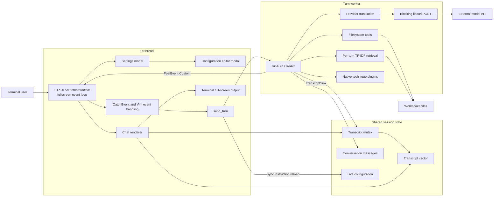
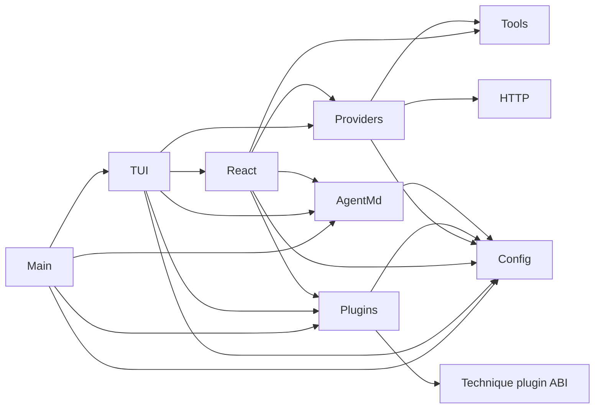
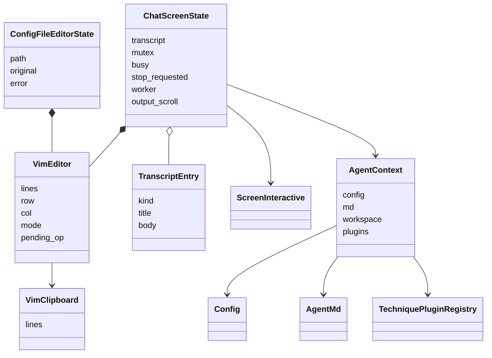
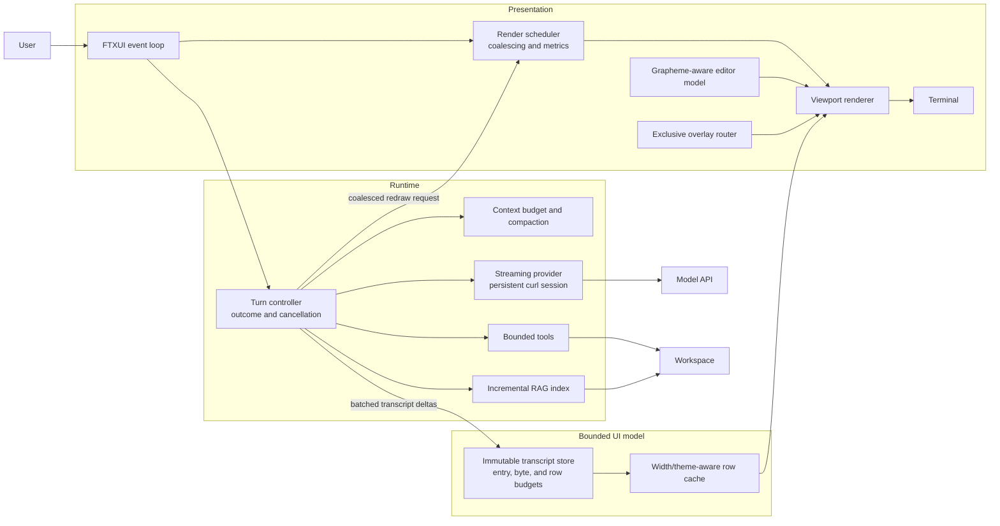

# OVI-CODE Performance and Console TUI Rendering Audit

**Audit date:** 2026-08-10  
**Scope:** Current working tree at `ef0ee5ac9c4aac340e3810a424e2c3b75bd6f2d8`  
**Overall assessment:** **Moderate architectural health, elevated performance risk under large transcripts, long sessions, and RAG workloads**

> No runtime latency benchmark exists, so this report does not claim measured
> frame rates or response times. Performance conclusions are static
> observations or derived scaling characteristics unless explicitly marked
> measured.

## 1. Executive Summary

OVI-CODE has a coherent single-process architecture and several sound TUI
safety practices: one fullscreen FTXUI screen, semantic theming, bounded
transcript entry count, a joined worker thread, serialized turns, and
deliberate cursor handling that fixes known flicker.

The main risk is that the rendering architecture scales with **all retained
transcript content**, not the visible viewport. Every invalidated frame
reparses and reconstructs the complete transcript while holding the mutex also
needed by the worker. FTXUI then computes layout and serializes the full
terminal screen. This design is likely adequate for short sessions but creates
a credible responsiveness bottleneck for large diffs, long assistant
responses, or transcripts approaching the 1,000-entry cap.

Additional performance risks occur before content reaches the UI:

1. Provider calls are blocking and non-streaming.
2. HTTP cannot be cancelled while `curl_easy_perform()` is active.
3. Conversation history and tool payloads have no size budget.
4. RAG rebuilds an in-memory TF-IDF corpus on every RAG turn.
5. Filesystem tools can return unbounded whole-file or whole-tree results.

### Strengths to preserve

- One `ScreenInteractive` and modal overlays avoid alternate-buffer flashing.
- The terminal hardware cursor is explicitly hidden on every render.
- Worker ownership and joining avoid detached-thread lifetime errors.
- Turns are serialized with `busy.exchange(true)`.
- Transcript eviction is batched.
- Read/list transcript previews are bounded.
- No direct internal include cycles were detected.
- The current Release build succeeds without compiler warnings.

### Highest-value actions

1. **Instrument first:** measure event-to-frame latency, renderer phases,
   mutex hold time, terminal bytes, request size, and shutdown latency.
2. **Contain transcript cost:** add byte/line budgets, move formatting outside
   the mutex, and disable unused mouse tracking.
3. **Cache and virtualize rendering:** format entries once and construct only
   visible or near-visible rows.
4. **Add cooperative cancellation and rate-limited streaming:** do not post one
   redraw per token.
5. **Bound context, tools, and RAG:** introduce request budgets, pagination,
   iterator pruning, and an incremental retrieval index.

No rewrite is justified. The risks can be addressed incrementally while
retaining the current public behavior.

## 2. Scope, Assumptions, and Limitations

### Repository state

- Branch: `main`, tracking `origin/main`
- Commit: `ef0ee5ac9c4aac340e3810a424e2c3b75bd6f2d8`
- The workspace was dirty during analysis.
- Tracked changes: **+1,156 / -401 lines across 10 files**
- Relevant uncommitted changes:
  - `src/tui.cpp`: **+393 / -167**
  - `src/react.cpp`: **+3 / -2**
- Untracked documentation, workflow, and generated `site/` content were
  present.

All source citations and code measurements refer to the current working tree,
not pristine `HEAD`.

### Included

Production scope follows `add_executable(ovi-code ...)` in
`CMakeLists.txt:36-46`:

- 9 implementation files under `src/`
- 9 public headers under `include/ovicode/`
- Fetched FTXUI v5 source was inspected to understand rendering behavior but
  excluded from project metrics.

### Excluded

| Area | Reason |
|---|---|
| `build/`, including `_deps/` | Generated build output and vendored dependencies |
| `site/` | Generated documentation |
| `cpp-agent/` | Research/prototype implementations, not linked into the executable |
| `plugins/examples/deliberate.cpp` | Example plugin, not application production code |
| `docs/`, packaging, scripts | Supporting artifacts, not runtime code |
| `.git/`, `.cache/` | Repository/cache metadata |

### Limitations

- No test, benchmark, profiler, coverage, or lint target exists.
- No `cloc`, `scc`, `lizard`, `cppcheck`, `clang-tidy`, or `hyperfine`
  executable was available.
- Complexity is a reproducible lexical approximation, not AST-based McCabe
  complexity.
- Duplication percentage, cohesion metrics, and test coverage are unavailable.
- The TUI was not dynamically profiled and provider requests were not
  executed.
- Native plugin runtime behavior cannot be bounded from static inspection.

## 3. Project and Architecture Overview

### Technology stack

| Area | Technology |
|---|---|
| Language | C++20 |
| Build | CMake 3.20+, default Release |
| TUI | FTXUI v5.0.0 |
| JSON | nlohmann/json v3.11.3 |
| HTTP | System libcurl |
| Plugins | Native `.dylib`/`.so`, versioned C ABI |
| Concurrency | FTXUI event loop plus one joinable turn worker |
| Persistence | JSON configuration and Markdown instruction files |
| Deployment | Single executable plus optional native modules |

### Major responsibilities

| Module | Responsibility |
|---|---|
| `main` | CLI, splash, setup/chat dispatch |
| `tui` | Wizard, settings, Vim editor, transcript, rendering, events, worker lifecycle |
| `react` | ReAct loops, RAG, plugins, transcript emissions |
| `providers` | Provider-specific request/response translation |
| `http` | Blocking libcurl POST |
| `tools` | Sandboxed file reading, listing, editing |
| `agent_md` | Instruction loading and system-prompt assembly |
| `config` | Persistent configuration, model catalogs |
| `plugins` | Native plugin discovery and lifecycle |

### Current-state component diagram



### Runtime flow

- UI events execute on the FTXUI loop.
- Submission reloads Markdown instructions on the UI thread and starts a
  worker.
- Model, RAG, tools, and plugins run on that worker.
- Transcript entries are appended under a mutex.
- Each entry posts `Event::Custom`.
- The next invalid frame reconstructs the complete transcript DOM and terminal
  frame.

## 4. Methodology and Tooling

### Methods

| Measurement | Method |
|---|---|
| Physical/code/comment/blank LOC | Direct line count plus lexical comment/string scanner |
| Functions | Brace-aware lexical function scanner |
| Complexity | `1 + if + for + while + case + catch` |
| Extended complexity | Approximate CC plus `&&`, `||`, and `?` |
| Dependencies | Direct quoted `#include "ovicode/..."` graph |
| Cycles | DFS over collapsed module graph |
| Churn | `git log --numstat` over relevant files |
| Rendering behavior | Inspection of application and pinned FTXUI v5 source |
| Build validation | `cmake --build build -j 8` |
| Test inventory | `ctest --test-dir build -N` |

Lambdas were not counted as named functions, but their decisions were folded
into their containing function. This inflates complexity for callback-heavy
TUI coordinator functions but reflects their total decision burden.

### Thresholds

| Indicator | Threshold |
|---|---:|
| Long function | More than 80 physical lines |
| High approximate complexity | CC greater than 10 |
| Very high approximate complexity | CC greater than 20 |
| Oversized source file | More than 500 physical lines |
| Transcript cap | 1,000 entries; approximately 901 retained after eviction |

These are prioritization thresholds, not claims that every violation is
defective.

## 5. Metrics Dashboard

### Repository summary

| Metric | Value | Status/method |
|---|---:|---|
| Production files | 18 | Measured: 9 source, 9 public headers |
| Physical LOC | 4,983 | Measured |
| Code LOC | 4,325 | Measured lexical source lines |
| Comment-only lines | 225 | Measured |
| Blank lines | 433 | Measured |
| Average file size | 276.83 physical lines | Derived |
| Maximum file size | 2,102, `src/tui.cpp` | Measured |
| Named functions | 144 | Measured lexical count |
| Struct/class definitions | 29 | 28 structs, 1 class |
| Enums | 10 | Measured |
| Functions with CC >10 | 17, 11.8% | Derived |
| Functions with CC >20 | 7, 4.9% | Derived |
| Long functions | 11 | Measured threshold count |
| Oversized source files | 3 | `tui`, `config`, `providers` |
| Direct internal dependencies | 20 | Measured |
| Direct include cycles | 0 | Measured |
| Test files/tests | 0 / 0 | Measured |
| Test-to-production code ratio | 0% | Derived from zero test LOC |
| Coverage | Unavailable | No coverage system |
| Duplication | Unavailable | No compatible analyzer |
| Runtime latency/frame rate | Unavailable | No benchmark |
| Build | Passed | Release build, no warnings observed |

### Module comparison

| Module | Physical LOC | Code LOC | Functions | Long | CC >10 | Fan-out |
|---|---:|---:|---:|---:|---:|---:|
| `tui` | 2,102 | 1,805 | 56 | 5 | 6 | 5 |
| `config` | 530 | 480 | 34 | 0 | 1 | 0 |
| `providers` | 515 | 484 | 12 | 2 | 3 | 3 |
| `react` | 448 | 389 | 11 | 2 | 3 | 5 |
| `tools` | 320 | 291 | 10 | 1 | 1 | 0 |
| `main` | 284 | 261 | 6 | 0 | 2 | 4 |
| `plugins` | 191 | 166 | 9 | 1 | 1 | 2 |
| `agent_md` | 107 | 90 | 3 | 0 | 0 | 1 |
| `http` | 69 | 55 | 3 | 0 | 0 | 0 |

`src/tui.cpp` represents **46.0% of implementation physical LOC** and
**44.9% of implementation code LOC**.

#### Production code by module

Units: code LOC; each block is approximately 100 lines.

```text
tui        1805  ##################
providers   484  #####
config      480  #####
react       389  ####
tools       291  ###
main        261  ###
plugins     166  ##
agent_md     90  #
http         55  #
```

### Complexity distribution

| Approximate CC | Functions | Share |
|---|---:|---:|
| 1-5 | 108 | 75.0% |
| 6-10 | 19 | 13.2% |
| 11-20 | 10 | 6.9% |
| 21-30 | 5 | 3.5% |
| Above 30 | 2 | 1.4% |

The majority of functions are simple. Risk is concentrated in a small number
of large coordinators.

### Top hotspots

| Function | Lines | Approx. CC | Primary risk |
|---|---:|---:|---|
| `runChatScreen`, `src/tui.cpp:1694-2100` | 407 | 35 | Rendering, concurrency, state, events, shutdown |
| `makeSettingsPanel`, `src/tui.cpp:718-1110` | 393 | 27 | Large modal coordinator |
| `runSetupWizard`, `src/tui.cpp:417-677` | 261 | 24 | Large rendering/event coordinator |
| `handleVimEditorEvent`, `src/tui.cpp:1380-1497` | 118 | 41 | Highest CC; byte-indexed editing |
| `callAnthropic`, `src/providers.cpp:340-493` | 154 | 29 | Request/response translation |
| `ragContext`, `src/react.cpp:109-222` | 114 | 26 | Full workspace index per turn |
| `parseOpenAIResponse`, `src/providers.cpp:175-278` | 104 | 30 | Complex wire parsing |
| `makeConfigFileEditorPanel`, `src/tui.cpp:1563-1690` | 128 | 12 | Full-buffer rendering and I/O |

### Smell indicator distribution

Counts are separate dimensions and should not be summed as one score.

| Module | Distinct flagged functions | Oversized file | Whole-transcript render | Byte-unbounded cap | Sync full-file UI I/O | Byte-indexed editor |
|---|---:|---:|---:|---:|---:|---:|
| `tui` | 6 | 1 | 1 | 1 | 4 | 1 |
| `providers` | 3 | 1 | 0 | 0 | 0 | 0 |
| `react` | 3 | 0 | 0 | 0 | 0 | 0 |
| `main` | 2 | 0 | 0 | 0 | 0 | 0 |
| `config` | 1 | 1 | 0 | 0 | 0 | 0 |
| `plugins` | 1 | 0 | 0 | 0 | 0 | 0 |
| `tools` | 1 | 0 | 0 | 0 | 0 | 0 |
| `agent_md` | 0 | 0 | 0 | 0 | 0 | 0 |
| `http` | 0 | 0 | 0 | 0 | 0 | 0 |

### Change hotspot

Committed history contains only 13 commits, so churn evidence is useful but
immature:

- `src/tui.cpp`: 9 commits, **2,571 additions / 695 deletions**
- TUI source/header represented **83.3%** of changed lines among selected
  performance/TUI files.
- Current uncommitted `tui.cpp` changes add another **393 additions / 167
  deletions**.

## 6. UML and Dependency Views

### Internal module dependencies



There are no direct include cycles. `tui` and `react` have the highest fan-out
at five modules each. `config` has the highest fan-in at six, which is expected
for shared configuration but makes its contracts broadly consequential.

### Key TUI state relationships

`ChatScreenState` below is a conceptual grouping of function-local state in
`runChatScreen`, not an actual class.



The conceptual session aggregate is currently spread across captures in a
407-line function. This makes lifetime relationships implicit rather than
compiler-enforced.

### Representative turn and render sequence

```mermaid
sequenceDiagram
    actor User
    participant Loop as FTXUI event loop
    participant Send as send_turn
    participant Worker as Turn worker
    participant React as runTurn / ReAct
    participant Provider as Provider + HTTP
    participant API as Model API
    participant Transcript as Transcript + mutex
    participant Render as Chat renderer
    participant Terminal

    User->>Loop: Enter in Normal mode
    Loop->>Send: Submit prompt
    Send->>Send: Reload agent/tools/skills Markdown
    Send->>Worker: Start thread
    Worker->>React: runTurn()

    loop ReAct passes
        React->>Provider: Full conversation request
        Provider->>API: Blocking POST, stream=false
        API-->>Provider: Complete response body
        Provider-->>React: Parsed response/tool calls
        React->>Transcript: Append entry under mutex
        React->>Loop: PostEvent(Custom)
    end

    Loop->>Render: Invalid frame
    Render->>Transcript: Lock and rebuild every entry
    Render->>Terminal: Layout and serialize full screen
```

## 7. Detailed Findings

### Finding summary

| ID | Severity | Finding |
|---|---|---|
| PT-01 | High | Every frame rebuilds the full transcript under the worker mutex |
| PT-02 | High | Provider I/O is non-streaming and not cooperatively cancellable |
| PT-03 | High | Conversation payloads grow without a context budget |
| PT-04 | High, RAG-specific | RAG rebuilds an expensive corpus index every turn |
| PT-05 | High | Vim editor uses byte offsets for UTF-8 text |
| PT-06 | Medium | Events, mouse tracking, and modal composition amplify redraw cost |
| PT-07 | Medium | Filesystem tools can produce unbounded payloads |
| PT-08 | Medium | TUI complexity and churn lack regression safety |
| PT-09 | Medium | Wrapping and scrolling policies are inconsistent |
| PT-10 | Medium | Turn outcome and shutdown lifecycle are ambiguous |
| PT-11 | Low | Fixed splash delay and FTXUI idle wakeups add background overhead |

### PT-01: Full transcript rendering under the mutex

**Evidence**

- `renderEntry()` reparses every entry body on every frame:
  `src/tui.cpp:1144-1186`.
- The renderer holds `mu` while formatting every retained entry:
  `src/tui.cpp:1987-1993`.
- Viewport framing is applied only after all entries have become DOM nodes:
  `src/tui.cpp:2002-2004`.
- The cap limits entries, not body bytes or lines: `src/tui.cpp:1724-1739`.
- Edit diffs are not truncated: `src/react.cpp:49-55`.
- FTXUI recomputes layout and serializes every screen cell: fetched FTXUI
  `screen_interactive.cpp:729-819` and `screen.cpp:416-445`.

**Derived scaling:** approximately
`O(retained lines + retained words + terminal width * height)` per invalid
frame.

**Impact:** Input, scrolling, status changes, and worker delivery can all slow
as transcript content grows. The worker may wait for a long renderer-held
mutex.

**Root cause:** Transcript entries are retained as semantic strings and
transformed from scratch at render time; there is no row cache or viewport
virtualization.

**Recommendation:** Add byte/line budgets, immutable entry snapshots, cached
formatted rows, and visible-range rendering.

**Effort:** L  
**Implementation risk:** Medium  
**Confidence:** High in the static behavior; runtime magnitude unmeasured.

### PT-02: Blocking, non-streaming, non-cancellable provider calls

**Evidence**

- OpenAI-compatible requests explicitly send `"stream": false`:
  `src/providers.cpp:299-305`.
- Anthropic follows the same full-response flow:
  `src/providers.cpp:410-448`.
- `curl_easy_perform()` blocks: `src/http.cpp:58`.
- Default total timeout is 120 seconds: `include/ovicode/http.hpp:14-19`.
- `stop_requested` is set only after the FTXUI loop returns:
  `src/tui.cpp:2094-2098`.
- There is no libcurl progress callback linked to cancellation.

**Impact:** No assistant content appears until the full response is complete.
Quitting during an active request may wait until curl returns.

**Root cause:** The HTTP abstraction models a request as a single blocking
`post()` returning a completed body.

**Recommendation:** Introduce a cancellation token and curl progress callback
first; then add provider streaming with updates coalesced to at most 20-30
frames per second.

**Effort:** L  
**Implementation risk:** Medium-High  
**Confidence:** High.

### PT-03: Unbounded conversation growth and repeated copying

**Evidence**

- Conversation messages remain for the session: `src/tui.cpp:1698`.
- Clearing the transcript does not clear messages: `src/tui.cpp:1883-1886`.
- Every ReAct iteration copies all messages and tool definitions:
  `src/react.cpp:232-236`.
- Full tool results are retained in conversation history:
  `src/react.cpp:264-271`.
- Providers build another JSON DOM and serialized request body:
  `src/providers.cpp:299-335`, `340-440`.

**Derived scaling:** If each pass adds similar history, cumulative
serialization and upload across `N` requests trend toward `O(N^2)`.

**Impact:** Longer request construction, larger uploads, higher memory use,
context-limit failures, and increasing provider cost.

**Root cause:** There is no explicit context ownership or token/byte budget.

**Recommendation:** Add serialized-byte/token accounting, tool-result
compaction, older-turn summarization, and request views that avoid unnecessary
deep copies.

**Effort:** L  
**Risk:** Medium  
**Confidence:** High in growth behavior; latency impact unmeasured.

### PT-04: RAG corpus rebuilding

**Evidence**

- `ragContext()` recursively scans the workspace for each RAG turn:
  `src/react.cpp:109-147`.
- `.git` and `build` entries are skipped but recursion is not pruned with
  `disable_recursion_pending()`: `src/react.cpp:121-136`.
- Every candidate file up to 1 MiB is read and tokenized.
- Per-document term maps and a global IDF map are constructed.
- A second weighted map is allocated for each document:
  `src/react.cpp:156-196`.
- All positive hits are sorted even though only four are retained:
  `src/react.cpp:198-200`.
- Selected files are read a second time: `src/react.cpp:203-219`.
- No cancellation, total byte cap, binary detection, or cache exists.

**Impact:** Large repositories can incur substantial pre-request CPU,
allocation, and filesystem work while the TUI shows no retrieval progress.

**Root cause:** An in-memory retrieval pipeline is rebuilt instead of
incrementally maintained.

**Recommendation:** Prune iterators, enforce a global file/byte budget, filter
binaries/generated paths, tokenize directly into counts, use bounded top-K
selection, and cache by path/size/mtime.

**Effort:** L  
**Risk:** Medium; retrieval ranking can change  
**Confidence:** High.

### PT-05: Byte-indexed Vim editor

**Evidence**

- Cursor position is an integer offset into `std::string`:
  `src/tui.cpp:1200-1205`.
- Movement, deletion, and insertion advance one byte:
  `src/tui.cpp:1246-1287`, `1332-1375`.
- Cursor rendering extracts `substr(col, 1)`: `src/tui.cpp:1517-1525`.

**Impact:** Accented characters, emoji, combining marks, and CJK glyphs can be
split or displayed with an incorrect cursor.

**Root cause:** The editor conflates byte offsets, Unicode graphemes, and
terminal display columns.

**Recommendation:** Maintain byte-offset/grapheme/display-column mappings
using FTXUI's UTF-8 helpers or a dedicated segmentation library.

**Effort:** M-L  
**Risk:** Medium  
**Confidence:** High.

### PT-06: Redraw amplification and hidden modal rendering

**Evidence**

- FTXUI invalidates the frame after every dispatched event: fetched
  `screen_interactive.cpp:681-697`.
- Mouse tracking is enabled by default: fetched
  `screen_interactive.hpp:37-38,93`.
- The application does not disable it, despite not implementing meaningful
  chat mouse interaction.
- FTXUI `Modal` always renders the main component before the overlay: fetched
  `modal.cpp:29-38`.
- Nested modals can render chat, settings, and the file editor in one frame:
  `src/tui.cpp:2089-2092`.

**Impact:** Mouse motion, key repeat, or typing in a modal can trigger complete
transcript rendering without changing transcript content.

**Root cause:** Library defaults and compositional modal rendering are combined
with an expensive root renderer.

**Recommendation:** Disable unused mouse tracking immediately. Move the file
editor to an exclusive tab/view, or freeze/cache modal backgrounds.

**Effort:** S for mouse; M for view restructuring  
**Risk:** Low-Medium  
**Confidence:** High for behavior, medium for runtime severity.

### PT-07: Unbounded filesystem tool payloads

**Evidence**

- `read_file` reads complete files without a limit: `src/tools.cpp:97-148`.
- `list_files` recursively accumulates the full result:
  `src/tools.cpp:151-190`.
- It does not prune `.git` traversal and does not exclude `build/` or `site/`.
- `edit_file` rewrites whole files and produces a diff containing every old/new
  line: `src/tools.cpp:204-222`, `271-306`.
- Transcript previews are bounded, but complete results remain in conversation
  history.

**Impact:** One large file, listing, or edit can inflate memory, requests, and
transcript render cost for the rest of the session.

**Root cause:** UI preview limits are being used as a substitute for execution
and context limits.

**Recommendation:** Add pagination, offset/line/byte limits,
ignored-directory pruning, maximum result sizes, and bounded contextual diffs.

**Effort:** M  
**Risk:** Medium because tool schemas and model behavior change  
**Confidence:** High.

### PT-08: TUI monolith and missing regression safety

**Evidence**

- `src/tui.cpp` is 2,102 lines and 46.0% of implementation PLOC.
- Six TUI functions exceed CC 10; four exceed CC 20.
- `runChatScreen()` is 407 lines with approximate CC 35.
- TUI files dominate selected-file churn.
- There are no tests or benchmarks.

**Impact:** Rendering optimizations are harder to isolate, validate, and roll
back. Event, lifetime, and presentation concerns change together.

**Root cause:** Feature growth accumulated in function-local state and captured
lambdas without test seams.

**Recommendation:** Extract transcript model/view, editor model, turn
controller, and overlay router after behavior tests exist.

**Effort:** L  
**Risk:** Medium  
**Confidence:** High.

### PT-09: Wrapping and scrolling inconsistencies

**Evidence**

- Prose uses `paragraph()`, which splits only on ASCII spaces:
  `src/tui.cpp:1179-1184` and fetched FTXUI `paragraph.cpp:14-38`.
- Diff and editor lines use non-wrapping `text()` elements.
- The editor has vertical framing but no horizontal viewport:
  `src/tui.cpp:1628-1630`, `2048-2052`.
- Output scrolling moves by 5% of document height:
  `src/tui.cpp:1717-1719`, `1919-1928`.
- Header model/plugin labels are unbounded: `src/tui.cpp:2012-2031`.

**Impact:** Long paths and code lines can be clipped, scroll steps become
coarse as history grows, and narrow terminals can hide status information.

**Recommendation:** Define explicit policies for prose, code/diffs, editor
horizontal movement, and header truncation. Store scroll in logical rows rather
than a percentage.

**Effort:** M  
**Risk:** Low-Medium  
**Confidence:** High.

### PT-10: Turn outcome and shutdown lifecycle

**Evidence**

- `runTurn()` returns `void`: `include/ovicode/react.hpp:33-38`.
- Provider/tool/plugin failures emit errors and return.
- The worker then appends a green `done` marker whenever shutdown was not
  requested: `src/tui.cpp:1843-1848`.
- The worker can post events while the screen is exiting; FTXUI's
  `task_sender_` lifecycle is not visibly synchronized with those posts.

**Impact:** Failed turns can appear successful. Quit behavior has a narrow
posting race and can block on I/O or a non-cooperative plugin.

**Recommendation:** Return `Completed`, `Failed`, or `Cancelled`; set
cancellation before requesting loop exit; suppress posts once closing begins.

**Effort:** M  
**Risk:** Low-Medium  
**Confidence:** High for outcome issue, medium for the FTXUI race.

### PT-11: Low-priority fixed and idle overhead

- Startup deliberately sleeps for 1,200 ms: `src/main.cpp:39-73`.
- FTXUI posts animation tasks every 15 ms: fetched
  `screen_interactive.cpp:324-330`.
- Those animation tasks normally do not invalidate a frame unless animation
  was requested.

This is unlikely to dominate active TUI latency but may affect perceived
startup and idle energy use.

### Positive practices worth preserving

- Single-screen modal architecture and cursor hiding directly address
  documented flicker.
- Semantic palette use supports dark/light/plain themes.
- Worker notification occurs after releasing the transcript lock.
- FTXUI drains queued tasks before drawing, providing some event coalescing.
- Transcript eviction is batched rather than performed on every insertion.
- Settings are blocked during active turns.
- Build warnings are enabled and the current build is clean.
- Direct internal dependencies are acyclic.

## 8. Recommendations and Target Architecture

### Prioritization model

Planning score:

```text
Score = 2 * Impact + Urgency + Confidence - Effort - Implementation risk
```

Each factor is rated 1-5. Scores are prioritization judgments, not measured
project metrics.

| ID | Recommendation | Score | Prerequisites |
|---|---|---:|---|
| R1 | Add performance telemetry and deterministic PTY benchmarks | 17 | None |
| R2 | Add transcript byte/line caps, short lock scope, and disable mouse | 16 | R1 preferred |
| R3 | Cache formatted rows and virtualize the transcript viewport | 13 | R1, R2 |
| R4 | Add cancellation, outcome states, streaming, and redraw coalescing | 13 | R1 |
| R5 | Add context, tool, and RAG budgets | 13 | R1 |
| R6 | Make the editor Unicode-aware and define layout policies | 12 | PTY test corpus |
| R7 | Extract TUI state/model/rendering seams | 10 | R1-R3 tests |

### Target-state principles

1. Rendering cost should track visible rows and changed content.
2. Worker/UI synchronization should exchange immutable snapshots or deltas.
3. Cancellation should propagate through HTTP, retrieval, tools, and plugins.
4. Every potentially large payload should have an explicit budget.
5. Streaming should be time/byte coalesced rather than token-triggered.
6. The existing single-screen modal and semantic palette behavior should
   remain.

### Proposed target architecture



### Trade-offs and deferred alternatives

- **Full rewrite rejected:** no evidence shows incremental seams are
  impractical.
- **Separate settings screen rejected:** it would reintroduce known
  alternate-buffer flashing.
- **One redraw per token rejected:** it would amplify the current renderer
  bottleneck.
- **Patching FTXUI's full-frame output deferred:** first measure whether DOM
  construction, terminal serialization, or terminal emulator throughput
  dominates.
- **Force-stopping plugin threads rejected:** unsafe in-process. Process
  isolation is a future option if bounded plugin shutdown becomes a
  requirement.
- **Persistent RAG daemon deferred:** an mtime-based in-process cache is a
  lower-risk first step.

## 9. Implementation Roadmap

Effort scale for one experienced engineer:

- **XS:** up to 1 day
- **S:** 2-3 days
- **M:** 4-10 days
- **L:** 2-4 weeks
- **XL:** more than 4 weeks

All effort values are estimates.

| Phase | Work | Findings | Owner role | Effort | Acceptance criteria |
|---|---|---|---|---:|---|
| Immediate | Add render, lock, event, request-size, and shutdown telemetry | All | TUI/runtime maintainer | M | PTY benchmark reports p50/p95/p99 without provider access |
| Immediate | Disable chat mouse tracking; add transcript byte/line and diff-preview limits | PT-01, PT-06, PT-07 | TUI maintainer | S | Mouse movement causes no chat redraw; caps emit visible elision markers |
| Immediate | Set cancellation before loop exit and return explicit turn outcomes | PT-02, PT-10 | Runtime maintainer | M | Failed/cancelled turns never display success; stalled mock request cancels |
| Near term | Snapshot immutable entries and format outside the mutex | PT-01 | TUI maintainer | M | Renderer mutex hold excludes entry parsing/DOM construction |
| Near term | Cache rows and construct only viewport plus overscan | PT-01, PT-06 | TUI maintainer | L | 1,000-entry fixture stays within agreed frame target |
| Near term | Replace nested file-editor modal with an exclusive view | PT-06 | TUI maintainer | M | Editing cost does not depend on transcript size |
| Near term | Add read/list pagination, iterator pruning, and output limits | PT-07 | Tooling maintainer | M | Tool results cannot exceed configured limits |
| Near term | Add RAG byte/file limits and mtime cache | PT-04 | Retrieval maintainer | L | Ignored trees are not traversed; unchanged second query reuses index |
| Medium term | Add curl cancellation and coalesced provider streaming | PT-02 | Network maintainer | L | Streaming capped at 20-30 UI updates/s; fallback remains available |
| Medium term | Add context budget and compaction | PT-03 | Agent runtime maintainer | L | Serialized request cannot exceed configured budget |
| Medium term | Implement grapheme-aware editing and horizontal viewport | PT-05, PT-09 | TUI maintainer | L | Unicode corpus passes cursor/edit golden tests |
| Medium term | Extract transcript, editor, overlay, and turn-controller modules | PT-08 | Principal/TUI maintainer | L | No coordinator function above agreed complexity threshold |
| Long term | Evaluate FTXUI upgrade, differential terminal output, and plugin isolation | PT-02, PT-06, PT-11 | Architecture team | XL | Proceed only when profiles demonstrate value |

### Safe migration strategy

1. Add instrumentation without changing visible behavior.
2. Preserve `TranscriptEntry` as the semantic producer contract.
3. Introduce a cached renderer behind an internal feature flag and compare
   golden PTY output.
4. Keep non-streaming provider calls as a fallback until stream assembly is
   validated.
5. Make context compaction visible through a system transcript entry.
6. Keep old/new rendering paths available for one release so regressions can
   be rolled back.
7. Use deterministic transcript fixtures; do not depend on live model output
   for rendering tests.
8. Run ThreadSanitizer around worker posting, cancellation, and screen shutdown
   before rollout.

### Traceability

| Finding | Recommendation | Phase | Acceptance/target |
|---|---|---|---|
| PT-01 | R1-R3 | Immediate/Near | p95 event-to-frame target; p99 lock hold below target |
| PT-02 | R1, R4 | Immediate/Medium | Mock stalled request exits within 1 second |
| PT-03 | R5 | Medium | No request exceeds configured budget |
| PT-04 | R5 | Near | Cached unchanged RAG turn avoids corpus rebuild |
| PT-05 | R6 | Medium | No invalid UTF-8; correct grapheme cursor placement |
| PT-06 | R2, R3 | Immediate/Near | No unused mouse redraws; modal cost independent of transcript |
| PT-07 | R5 | Near | Bounded/paginated tool output |
| PT-08 | R1, R7 | Medium | Tests exist; no new CC >20 without waiver |
| PT-09 | R6 | Medium | Narrow-terminal and long-line golden tests pass |
| PT-10 | R4 | Immediate | Explicit completed/failed/cancelled states |
| PT-11 | R1; defer optimization | Long | Measure idle CPU/wakeups before changing dependency |

## 10. Measurement and Governance Plan

### Baselines and proposed targets

Runtime targets are proposed engineering goals; current runtime baselines are
unavailable.

| Metric | Current baseline | Proposed target |
|---|---|---|
| Event-to-frame latency | Unavailable | p95 below 33 ms at 120x40 with 1,000 short entries |
| Transcript mutex hold | Unavailable | p99 below 2 ms |
| Stream redraw rate | No streaming | At most 20-30 frames/s |
| Quit during stalled HTTP | May wait for blocking request; 120 s timeout configured | p95 below 1 second using local stall mock |
| Transcript entries | 1,000 hard trigger | Retain entry cap plus explicit byte/row cap |
| Transcript body bytes | Unbounded | Configured hard budget with elision |
| Conversation context | Unbounded | Configured serialized-byte/token budget |
| RAG corpus work | Full rebuild each RAG turn | Incremental cache; bounded files and bytes |
| CC >20 | 7 functions | No new violations; reduce TUI coordinators incrementally |
| Tests | 0 | Unit, PTY golden, cancellation, and benchmark fixtures |
| Startup delay | Configured 1,200 ms | Optional splash delay; no forced delay by default |
| Idle wakeups | FTXUI targets about 67 tasks/s; actual CPU unknown | Measure first; optimize only if material |

### CI quality gates

1. Build Debug and Release on macOS and Linux.
2. Retain `-Wall -Wextra -Wpedantic`; fail CI on new warnings.
3. Run unit tests for transcript budgets, outcome states, tool limits, and
   editor operations.
4. Run PTY golden tests at 80x24, 120x40, and 200x60.
5. Run deterministic rendering benchmarks nightly.
6. After establishing stable baselines, fail only for:
   - more than 10% p95 regression and an absolute target violation;
   - unbounded transcript/context output;
   - new modified-function CC above 20 without waiver.
7. Run AddressSanitizer regularly and ThreadSanitizer on concurrency changes.
8. Maintain an allowlist for existing complexity violations rather than
   blocking unrelated delivery.

### Review cadence

- Per PR: static gates and small PTY corpus.
- Nightly: performance fixtures and sanitizers.
- Monthly: compare transcript, request-size, and RAG metrics.
- Quarterly: reassess FTXUI version, plugin isolation, and complexity
  allowlist.

## 11. Appendix

### Inventory summary

```text
Production source:
  src/agent_md.cpp
  src/config.cpp
  src/http.cpp
  src/main.cpp
  src/plugins.cpp
  src/providers.cpp
  src/react.cpp
  src/tools.cpp
  src/tui.cpp

Public headers:
  include/ovicode/*.hpp
  include/ovicode/technique_plugin.h

Tests:
  none

Benchmarks:
  none
```

### Reproduction commands

```bash
git rev-parse HEAD
git status --short --branch
git diff --stat
git diff --check

wc -l src/*.cpp include/ovicode/*.hpp include/ovicode/*.h

cmake --build build -j 8
ctest --test-dir build -N

git log --numstat -- \
  src/tui.cpp include/ovicode/tui.hpp \
  src/react.cpp include/ovicode/react.hpp \
  src/http.cpp include/ovicode/http.hpp
```

Complexity results used a brace-aware lexical scanner after removing comments
and quoted/raw strings:

```text
Approximate CC = 1 + if + for + while + case + catch
Extended CC    = Approximate CC + && + || + ?
```

### Glossary

- **Measured:** Direct count or tool output.
- **Derived:** Calculated from measured values.
- **Observed:** Qualitative conclusion directly supported by source.
- **Hypothesis:** Expected runtime effect requiring profiling.
- **PLOC:** Physical lines, including code, comments, and blanks.
- **Code LOC:** Lines remaining after lexical removal of blanks and
  comment-only content.
- **Viewport virtualization:** Constructing render nodes only for visible or
  near-visible rows.
- **TTFT:** Time to first token/content from a provider.
- **Fan-in/fan-out:** Number of direct internal modules depending on or used by
  a module.
